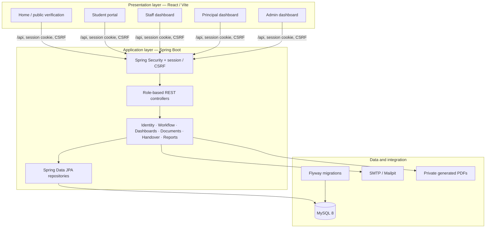
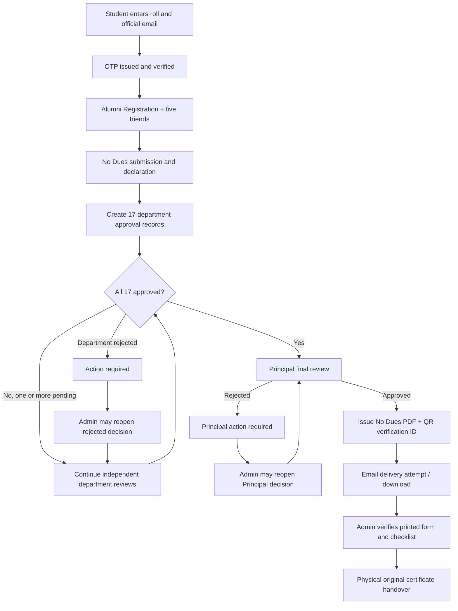
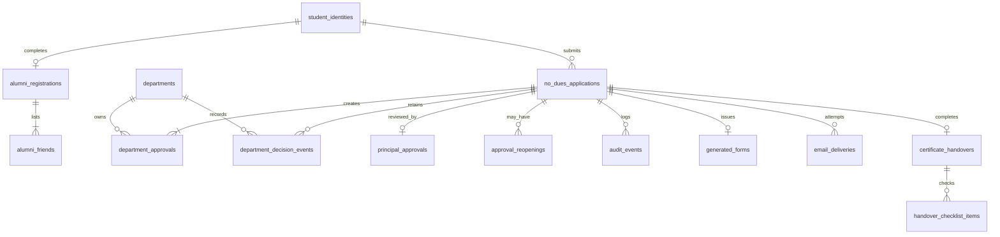

<div align="center">

# DCCMP
### Digital Campus Clearance and Certificate Management Platform

**A role-based campus workflow for Alumni Registration, No Dues clearance, 17-department approvals, Principal authorization, digital PDF verification, and physical certificate handover.**

**Usharama College of Engineering and Technology**

`Java 21` · `Spring Boot 4` · `Spring Security` · `Spring Data JPA` · `MySQL 8` · `Flyway` · `React 19` · `Vite 6` · `Tailwind CSS 4`

**Project status:** Development / local testing

[Overview](#1-project-overview) · [Architecture](#4-system-architecture) · [Workflow](#5-end-to-end-workflow) · [Setup](#10-local-setup) · [API](#12-api-reference) · [Testing](#13-testing-guide)

</div>

---

## 1. Project overview

**DCCMP** replaces the time-consuming, paper-driven No Dues process with a central application that records each clearance decision and makes application progress visible to authorized users. A student verifies their institutional email, completes **Alumni Registration**, submits a **No Dues application**, and waits for **17 independent departments** to decide. Once every department has approved, the **Principal** can make the final decision. If approved, the platform produces a verifiable No Dues PDF and supports administrative checks before original certificates are **physically handed over**.

> **Scope clarification:** DCCMP issues and verifies a **No Dues / clearance document**. It does **not** generate degree certificates, semester marksheets, or other original academic certificates. Their physical release remains an administrative action.

### 1.1 Problem statement

A manual clearance process creates repeated visits to offices, weak visibility into pending approvals, difficulty in identifying rejection reasons, and inconsistent audit records. DCCMP addresses those gaps through one tracked application and role-specific approval queues.

### 1.2 Objectives

1. Centralize student Alumni Registration and No Dues applications.
2. Require verifiable student access using roll-number-matched institutional email and OTP.
3. Route applications to **all 17 departments in parallel**, without branch-based exemptions.
4. Enforce department-only decisions, Principal-only final clearance, and Admin-only reopening.
5. Preserve decisions, remarks, reopening events, and timestamps for auditability.
6. Provide useful statistics to college leadership without exposing individual student records in aggregate exports.
7. Generate college-format PDFs with a verification identifier and QR code.
8. Record physical certificate collection separately from digital approval.

### 1.3 Intended users

| Role | Primary responsibility | Access boundary |
|---|---|---|
| **Student** | Verify identity, submit forms, track personal clearance, download own approved PDF | Own records only |
| **Department staff account** | Review pending applications, approve/reject, see departmental trends | Own department only |
| **Principal** | Review institution-wide progress, final approve/reject, view analytics and export reports | Cross-department oversight |
| **Admin** | Manage accounts, reopen rejected decisions, issue/resend forms, verify handover, export reports | Administrative operations, but **cannot impersonate departmental or Principal decisions** |

---

## 2. Technology stack

| Layer | Technologies | Purpose |
|---|---|---|
| Frontend | React 19, React Router 6, Vite 6, Tailwind CSS 4, Lucide React | Single-page responsive interface |
| Backend | Java 21, Spring Boot 4, Spring Web MVC | REST API and business services |
| Security | Spring Security, sessions, CSRF, BCrypt | Authentication, authorization, protected state changes |
| Persistence | Spring Data JPA, Hibernate, MySQL 8 | Database access and transactional workflow |
| Schema migration | Flyway | Versioned database changes |
| Mail | Spring Mail, SMTP; Mailpit for local tests | OTP and approved-PDF messages |
| Documents | Apache PDFBox 3, ZXing | No Dues PDFs and QR codes |
| Development | Maven, npm, Docker Compose (optional), IntelliJ IDEA | Build and local infrastructure |
| Testing | JUnit/Spring tests, project checks; Java Selenium (optional separate project) | Backend and browser verification |

The documented backend targets **Java 21**; a newer locally installed JDK may work but should be validated through Maven and integration tests.

---

## 3. Core features by portal

### 3.1 Student portal — `/student`

- Validate student roll number against the configured format and official email convention: `<lowercase-roll>@usharama.in`.
- Send a six-digit, time-limited email OTP; verify before allowing student-specific operations.
- Submit **Alumni Registration** with academic and personal details, plus exactly **five friends** with contact information.
- Submit **No Dues** only after Alumni Registration, including a declaration.
- Track the latest status and any latest departmental approval/rejection remarks.
- See the status and timestamp of each of the 17 departments, without employee identity details or prior decision cycles.
- View Principal decision and document/email/handover states.
- Download the issued No Dues PDF **only for their own approved application**.

### 3.2 Department Staff Dashboard — `/employee` after staff login

**Five sidebar pages:** Overview · Pending Approvals · All Requests · Decision History · Student Search.

- **Overview:** current pending/approved/rejected/total counts, approval percentage, average processing time, decision trends, and the five oldest pending requests.
- **Pending Approvals:** 10 records per server-paginated page, oldest first, search/filter/sort, confirmation dialogs, mandatory rejection remarks, optional approval remarks, and single-item actions.
- **Bulk approval:** 1–10 approvals selected **from the current page**; all-or-nothing database operation; no bulk rejection.
- **All Requests:** department status table including completed requests, with department-scoped details and applicable pending actions.
- **Decision History:** one row per decision event with timestamps and preserved history across reopenings.
- **Student Search:** exact/partial roll match; minimum 3 characters; debounce around 400 ms; no initial application load.
- **Details panel:** read-only relevant student/academic details, email and telephone with **Copy** buttons, departmental remarks/history; home address, complete Alumni Registration, other departmental decisions, and issued PDF are not exposed.
- **Mobile:** collapsible sidebar drawer; full-screen application details; horizontally scrollable tables; sticky bulk-action controls where applicable.

Staff **can view department analytics but cannot export reports**. Department Reports and My Performance are intentionally **not** separate sidebar pages.

**Shared account model:** The 17 departments each use one shared login (e.g. `LIBRARY`, `HOD_CSE`, `ACCOUNTS`). Audit attribution is to the **department account**, not an identifiable individual employee. Signing into an account again invalidates its prior authenticated session; multiple tabs in a single session are supported.

### 3.3 Principal Dashboard — `/employee` after Principal login

**Six sidebar pages:** Overview · Applications · Department Analytics · Student Search · Reports · Approval History.

- Institution-wide current application status cards and date filtering.
- Cross-department summary for **all 17 required approvals**.
- Student/application filters and detailed progress review.
- Individual student lookup, even if an application is still pending or rejected.
- Final approval **only after 17/17 departmental approvals**, or final rejection with required remarks.
- Download issued No Dues documents where authorized.
- Generate **aggregate-only** reports in PDF, XLSX, and CSV format.
- Review decision and reopening history.

### 3.4 Admin Dashboard — `/employee` after Admin login

- View application statistics, application records, departments, and audit history.
- Manage permitted employee accounts: reset passwords, rename department login IDs, manage access for other roles as supported.
- Keep the **17 permanent department accounts** associated with their original department; they cannot be deactivated through the protected Admin operations.
- Authorize a reopening of a **rejected department decision or Principal decision**, with a reason.
- Reissue or resend previously approved clearance documents when necessary.
- Perform the physical collection/verification checklist and record a one-time certificate handover.
- Download administrative aggregate PDF, Excel, and CSV reports.

---

## 4. System architecture

### 4.1 High-level component diagram



**Request path:** React page → `frontend/src/api.js` → Vite `/api` proxy (development) → Spring Security → REST controller → service/business rules → repository → MySQL → response → React state/UI. Documents and emails are generated/sent by backend services, never directly by the browser.

### 4.2 Backend layered architecture

All backend Java source resides under `backend/src/main/java/com/dccmp/backend/`.

| Package | Important responsibility |
|---|---|
| `controller/` | `AuthController`, `PublicController`, `StudentController`, `StaffController`, `PrincipalController`, `AdminController` expose REST endpoints |
| `service/` | `IdentityService`, `WorkflowService`, `StaffDashboardService`, `PrincipalDashboardService`, `DocumentService`, `AnalyticsExportService`, `HandoverService` implement the domain rules |
| `entity/` | JPA models for students, applications, approvals, accounts, documents, audit, handover, etc. |
| `repository/` | Spring Data JPA queries, pagination and persisted changes |
| `dto/` | API request/response records in `Records.java` |
| `security/` | Session access and role validation (`Access.java`) |
| `config/` | Spring Security, bootstrap Admin, optional demo account seeding |
| `exception/` | Consistent API error responses |
| `resources/db/migration/` | Flyway migration scripts |

**Design rule:** Access limits are enforced on the server. Hiding an action or field in React is not a substitute for backend authorization.

### 4.3 Frontend organization and routing

| Source file | Primary function |
|---|---|
| `src/main.jsx` | React entry point, Router and global stylesheet |
| `src/App.jsx` | Landing, employee sign-in, account controls, document verification, top-level routing |
| `src/Student.jsx` | Student identity, Alumni/No Dues forms, progress and PDF |
| `src/Staff.jsx` | Department-specific five-page dashboard |
| `src/Principal.jsx` | Six-page Principal dashboard |
| `src/Admin.jsx` | Administrative dashboard and actions |
| `src/components.jsx` | Shared UI components and navigation elements |
| `src/api.js` | CSRF-aware HTTP client and binary response handling |
| `src/index.css` | Global white/grey minimal responsive visual system |

Main client routes:

```text
/                 Public landing page
/student          Student verification, registration, tracking
/employee         Employee login and role-based dashboard
/verify/:token    Public limited-information PDF verification
```

**UI approach:** white backgrounds, whitespace, neutral shades, restrained accents, status colors used sparingly, consistent tables/forms, responsive mobile navigation. The frontend redesign does **not** require backend changes.

---

## 5. End-to-end workflow



### 5.1 Important workflow invariants

- **Exactly 17 mandatory departments** participate for every application, including HOD departments outside the student's branch.
- Department decisions are **parallel and independent**: another department can decide even when one has rejected.
- Staff can only act on approval records assigned to their account's department.
- A rejection requires non-whitespace remarks; approval remarks are optional.
- Submitted decision events are preserved in history. Reopening changes the *current state* but does not delete the previous audit trail.
- **Admin can reopen** a rejected department/Principal decision but cannot approve on their behalf.
- The Principal cannot approve while even one departmental decision is pending or rejected.
- A successful Principal approval and generated PDF **do not** mean original certificates have been handed over.
- Student-facing approval records omit staff identification and show the **latest status/remarks**, not the complete internal event history.

### 5.2 Application and decision states

| Dimension | Values |
|---|---|
| Application | `PENDING_DEPARTMENTS`, `ACTION_REQUIRED`, `PENDING_PRINCIPAL`, `PRINCIPAL_ACTION_REQUIRED`, `APPROVED` |
| Individual department | `PENDING`, `APPROVED`, `REJECTED` |
| Principal | `PENDING`, `APPROVED`, `REJECTED` |
| Email delivery | `EMAIL_PENDING`, `EMAIL_SENT`, `EMAIL_FAILED` (and `NOT_GENERATED` before an email record exists) |
| Handover | `NOT_COLLECTED`, `VERIFICATION_PENDING`, `HANDED_OVER` as represented in current views |

---

## 6. Departments

The following department records are seeded by `V2__departments.sql`. Each has its own independent approval and shared login account.

| # | Department | Department code |
|---:|---|---|
| 1 | EEE HOD | `hod_eee` |
| 2 | Civil HOD | `hod_civil` |
| 3 | ECE HOD | `hod_ece` |
| 4 | CSE HOD | `hod_cse` |
| 5 | Mechanical HOD | `hod_mech` |
| 6 | AI HOD | `hod_ai` |
| 7 | IT HOD | `hod_it` |
| 8 | Hostel | `hostel` |
| 9 | Canteen | `canteen` |
| 10 | Accounts | `accounts` |
| 11 | Scholarship | `scholarship` |
| 12 | Training and Placements | `training_placements` |
| 13 | Examination Section | `examinations` |
| 14 | Games and Sports | `sports` |
| 15 | Alumni | `alumni` |
| 16 | Library | `library` |
| 17 | Special Team | `special_team` |

In optional demo seeding mode, the department code becomes an uppercase staff login identifier (for example, `HOD_CSE`, `LIBRARY`), while the Principal demo login is `PRINCIPAL001`. An Admin login can be bootstrapped via `ADMIN_CODE` and `ADMIN_PASSWORD`.

---

## 7. Database design

The database uses MySQL 8, Hibernate/JPA entities, and Flyway migration history. Main tables:

| Table | Purpose |
|---|---|
| `student_identities` | Verified student identity and official email |
| `email_otps` | OTP hash, attempt and expiry state |
| `alumni_registrations` | Alumni Registration details |
| `alumni_friends` | Five associated friend entries |
| `no_dues_applications` | Submitted application and current overall state |
| `departments` | The 17 mandatory departments |
| `staff` | Admin, Principal and department accounts; password hashes and active session key |
| `department_approvals` | Current decision for each application/department pair |
| `department_decision_events` | Immutable historical decision cycles |
| `principal_approvals` | Current final-review state |
| `approval_reopenings` | Admin-authorized reopening details |
| `audit_events` | Application activity history |
| `generated_forms` | Issued form metadata and verification ID |
| `email_deliveries` | SMTP delivery attempt records |
| `certificate_handovers` | Physical collection record |
| `handover_checklist_items` | Verification checklist entries |

### 7.1 Entity-relationship overview



### 7.2 Database constraints and migrations

- There is a unique pair **`(application_id, department_id)`** in `department_approvals`: one *current* department record per application.
- Historic decisions are separate rows in `department_decision_events` and survive reopenings.
- Verified IDs, staff login codes and other designated fields have unique constraints.
- Flyway scripts in order:
  - `V1__schema.sql` — base tables, constraints and foreign keys.
  - `V2__departments.sql` — mandatory department list.
  - `V3__staff_dashboard.sql` — historical decision events and shared-account session key.
  - `V4__backfill_department_decisions.sql` — historical event backfill for existing decisions.
- Hibernate uses **`ddl-auto: validate`**. Flyway owns schema creation; application startup fails if Java mappings do not match schema.

> **Data safety:** Back up any existing campus data before applying migrations. Do not edit already-applied Flyway SQL, delete the Flyway history table, or reset production-like databases to fix application errors.

---

## 8. Security and privacy

### 8.1 Student identity

- An official roll-number/email pairing is required for OTP delivery.
- OTPs are generated server-side, BCrypt-hashed, single-use, and expire after **10 minutes** in the current implementation.
- OTP resend is rate-limited and incorrect OTP attempts are capped.
- Student records are scoped by the verified server-side session.

### 8.2 Employee authentication

- Employee passwords are stored as BCrypt hashes, not plaintext.
- Password policy for a new/changed employee password: **at least eight characters, including one letter and one number**.
- Login is case-normalized for account codes.
- After repeated failed logins, a locally generated **six-character image CAPTCHA** is required; the challenge is single-use with a five-minute expiry. The login failure counter is kept in server process memory.
- The application enforces **one active authenticated session per shared department account**; a newer login invalidates an older one.
- Staff/Principal/Admin inactivity cutoff: **30 minutes**; only recognized user-activity requests update the backend activity timestamp.
- Session cookies are HttpOnly; state-changing API requests use a CSRF token.
- Department APIs check the authenticated department before loading or changing records.

### 8.3 Sensitive data and reports

- Student contact email/phone can be read in authorized staff details and copied, but other departments' decisions and full Alumni Registration remain hidden.
- Staff do not get the final issued PDF or export permissions.
- Principal/Admin reporting exports contain aggregate metrics, **not student-by-student records**.
- Do not place real passwords, email OTPs, private student records, or `.env` secrets in Git.
- Enable HTTPS and secure cookies for deployment; configure trusted SMTP and review data retention/backup controls before real college rollout.

---

## 9. Repository structure

```text
DCCMP/
├── backend/
│   ├── pom.xml
│   ├── .env                        # Local; create yourself; do not commit
│   └── src/
│       ├── main/
│       │   ├── java/com/dccmp/backend/
│       │   │   ├── config/
│       │   │   ├── controller/
│       │   │   ├── dto/
│       │   │   ├── entity/
│       │   │   ├── exception/
│       │   │   ├── repository/
│       │   │   ├── security/
│       │   │   └── service/
│       │   └── resources/
│       │       ├── application.yml
│       │       └── db/migration/V1..V4*.sql
│       └── test/java/...
├── frontend/
│   ├── package.json
│   ├── vite.config.js
│   ├── index.html
│   ├── scripts/verify-frontend.mjs
│   └── src/
│       ├── main.jsx
│       ├── App.jsx
│       ├── Student.jsx
│       ├── Staff.jsx
│       ├── Principal.jsx
│       ├── Admin.jsx
│       ├── components.jsx
│       ├── api.js
│       └── index.css
├── reference-forms/
│   ├── Alumni_Registration(1).pdf
│   └── No_Dues(2).pdf
├── docs/
│   ├── ARCHITECTURE.md
│   └── API.md
├── docker-compose.yml
├── .env.example
└── README.md
```

**Frontend replacement note:** In the updated minimal-UI version, `index.css`, `components.jsx`, `App.jsx`, `Student.jsx`, `Staff.jsx`, `Principal.jsx`, and `Admin.jsx` were supplied as separate replacement files. Use the versions installed in your *current* working copy; this README does not overwrite any source files.

---

## 10. Local setup

### 10.1 Prerequisites

- Windows 10/11 or another supported development OS.
- **JDK 21** (recommended), Maven 3.9+, Node.js compatible with Vite 6, npm.
- **MySQL 8** running locally, or Docker Desktop with Compose.
- IntelliJ IDEA for the backend and a terminal/IDE for the frontend.
- Chrome for browser testing, if desired.

### 10.2 Start the database and local email inbox (Docker option)

From the repository root:

```powershell
docker compose up -d
```

`docker-compose.yml` provides a MySQL service and **Mailpit** local SMTP capture service. Standard local endpoints:

| Service | Address |
|---|---|
| MySQL | `localhost:3306` |
| Mailpit SMTP | `localhost:1025` |
| Mailpit inbox | `http://localhost:8025` |

If you use an already installed MySQL service instead, **do not start a second server on the same port**. Use your own database username/password and DB name.

### 10.3 Backend configuration

The Spring Boot file `backend/src/main/resources/application.yml` loads an optional **`./.env` relative to the backend process's current working directory**. For IntelliJ, set the **Run Configuration → Working directory** to your actual `DCCMP/backend` directory, or use environment variables in the Run Configuration.

Create `backend/.env` using your own local-only values, for example:

```dotenv
DB_URL=jdbc:mysql://localhost:3306/dccmp_db?createDatabaseIfNotExist=true
DB_USER=your_mysql_user
DB_PASSWORD=your_mysql_password
ADMIN_CODE=ADMIN001
ADMIN_PASSWORD=replace-with-a-strong-secret
APP_BASE_URL=http://localhost:5173
SMTP_HOST=localhost
SMTP_PORT=1025
SMTP_USER=
SMTP_PASSWORD=
SMTP_AUTH=false
SMTP_STARTTLS=false
MAIL_FROM=no-reply@usharama.in
SESSION_COOKIE_SECURE=false
DEMO_SEED_STAFF=true
DEMO_STAFF_PASSWORD=replace-with-a-long-local-test-password
```

**Important environment notes:**

- `.env` must remain uncommitted. The `.env.example` in the source is a template, not a real credentials file.
- For local testing, `DEMO_SEED_STAFF=true` provisions shared department and Principal accounts if absent. Do not turn this on casually against a populated real database.
- The Admin bootstrap password initializes the account when it is first created; changing `ADMIN_PASSWORD` later does **not** automatically reset a password already stored in MySQL.
- Use a dedicated test database (e.g. `dccmp_test`) before generating many fictional student records.
- The application uses a **private PDF output directory**; the `PDF_TEMPLATE` and `PDF_STORAGE` settings can override their default paths.
- For HTTPS production deployment set `SESSION_COOKIE_SECURE=true` and configure trusted SMTP credentials and a real application URL.

### 10.4 Start backend in IntelliJ IDEA

1. Open the `backend` Maven project.
2. Select JDK 21 and reload Maven.
3. Configure environment variables or the `backend/.env` file described above.
4. Ensure the working directory is `DCCMP/backend`.
5. Run `com.dccmp.backend.DccmpApplication`.
6. Confirm Flyway migrations and Tomcat startup in the Run console.

Or from PowerShell (working directory `backend`):

```powershell
mvn spring-boot:run
```

Default backend URL: **`http://localhost:8080`**.

### 10.5 Start the React frontend

In a **different terminal**:

```powershell
cd frontend
npm install
npm run dev
```

Open **`http://localhost:5173`**. The development Vite configuration forwards frontend `/api` requests to `http://localhost:8080`. Because the browser uses same-origin `/api` URLs through this proxy, no API URL replacement is needed for basic local development.

### 10.6 Development URLs

| Page/service | URL |
|---|---|
| Home | `http://localhost:5173/` |
| Student portal | `http://localhost:5173/student` |
| Employee sign-in | `http://localhost:5173/employee` |
| Public document verification | `http://localhost:5173/verify/<verification-id>` |
| Backend health | `http://localhost:8080/api/public/health` |
| OpenAPI/Swagger UI | `http://localhost:8080/swagger-ui.html` |
| Mailpit local inbox | `http://localhost:8025` |

### 10.7 First local walkthrough

1. Start MySQL, Spring Boot, frontend, and Mailpit (if using local SMTP).
2. Open the Student portal and provide a **fictional, format-valid roll** and corresponding email for local testing.
3. Read the captured OTP in Mailpit and verify the student session.
4. Submit Alumni Registration, including five friend entries containing fictional data.
5. Submit a No Dues application and verify creation of **17 `PENDING` department approvals**.
6. Sign into one of the seeded shared department accounts through Employee login; approve or reject its own application record.
7. Repeat across departments or use the documented 1–10 record bulk approval in each queue.
8. Sign in as Principal only after 17/17 approvals; approve the application.
9. Download and open the PDF; test the limited-information QR verification route.
10. Complete Admin verification and certificate handover in a **test dataset only**.

> Note: The application enforces one active employee session per account. When switching between student and employee roles in the same browser, use logout or separate isolated browser profiles to avoid unexpected session replacement.

---

## 11. Analytics, dates and report generation

### 11.1 Department Overview rules

- Status cards reflect the **current** department decision and filter by original application submission date.
- The default reporting period is **All Time**; Today, This Week, This Month and Custom Range are supported.
- Week boundaries are **Monday through Sunday**.
- Custom historical ranges can span multiple years, but must not extend into the future or reverse their start/end dates.
- The oldest-five pending preview is **not restricted** by Overview date filters.
- Decision trends count **historical approval/rejection events by their actual event dates**, including new cycles after Admin reopenings.
- Empty days/weeks/months/years remain visible at **zero** instead of being silently omitted.
- Trend grouping starts monthly, offers daily/weekly views, and may broaden to weekly/monthly/yearly to avoid excessive chart points. Yearly groups use **January–December**, not academic years.
- Department approval percentage = **approved current requests ÷ (approved + rejected current requests)** × 100; display N/A when none are decided.
- Mean decision processing time is measured **per completed decision cycle**; first submission to first decision, and reopening time to the next decision. Short averages appear in hours/minutes, longer averages in days/hours; N/A if there are no cycles.
- Pending duration is calculated from the **original application submission timestamp** and displayed in days/hours.
- User-facing dates/times use **Asia/Kolkata (IST)** and format `DD MMM YYYY, hh:mm AM/PM IST`.

### 11.2 Export policy and formats

- **Principal and Admin only:** PDF, XLSX, CSV aggregate department analytics reports.
- **Department staff:** read-only on-screen charts/summary statistics; no export endpoint permission.
- The current backend PDF export uses PDFBox with simple text/table content and compact activity bars. The XLSX export creates a minimal OOXML spreadsheet of numerical results; **it does not include a native embedded Excel chart**. CSV provides numerical tables without design elements.
- Full graphical reporting polish is a future enhancement; do not describe the current XLSX as having native charts unless that is implemented and tested.

---

## 12. API reference

All endpoints below are relative to **`/api`**. Authenticated browser requests use a session cookie and CSRF handling in `frontend/src/api.js`. Do not paste login passwords, OTPs or session cookies into issue reports.

### 12.1 Public and authentication

| Method | Endpoint | Purpose |
|---|---|---|
| `GET` | `/public/health` | Health status |
| `GET` | `/public/csrf` | CSRF token preparation |
| `GET` | `/public/departments` | Department list |
| `POST` | `/public/otp/send` | Send official-email student OTP |
| `POST` | `/public/otp/verify` | Verify OTP and establish student session |
| `GET` | `/public/verify/{token}` | Limited public PDF authenticity details |
| `GET` | `/auth/captcha` | Generate employee login CAPTCHA |
| `POST` | `/auth/login` | Employee sign-in |
| `GET` | `/auth/me` | Current employee profile |
| `POST` | `/auth/touch` | Register eligible user activity |
| `POST` | `/auth/change-password` | Employee password change |
| `POST` | `/auth/logout` | End session |

### 12.2 Student

| Method | Endpoint | Purpose |
|---|---|---|
| `GET` | `/student/me` | Verified student profile |
| `POST` / `GET` | `/student/alumni` | Submit or view own Alumni Registration |
| `POST` | `/student/no-dues` | Submit a No Dues application |
| `GET` | `/student/applications` | Own applications and latest decisions |
| `GET` | `/student/approved-form/{id}` | Own approved clearance PDF |

### 12.3 Department staff

| Method | Endpoint | Purpose |
|---|---|---|
| `GET` | `/staff/overview` | Current metrics, trends and five oldest pending |
| `GET` | `/staff/requests` | Filtered/paginated department requests |
| `GET` | `/staff/search?roll=...` | Department-scoped roll search (3+ chars) |
| `GET` | `/staff/requests/{id}` | Department-scoped application details |
| `GET` | `/staff/history` | Historical department decision events |
| `PATCH` | `/staff/approvals/{id}/approve` | Approve an assigned pending request |
| `PATCH` | `/staff/approvals/{id}/reject` | Reject with required remarks |
| `POST` | `/staff/bulk-approve` | Transactional approval of 1–10 selected approval IDs |

Common optional `GET /staff/requests` query fields: `page`, `status`, `roll`, `name`, `branch`, `sort`. Server pages are **zero-indexed** and contain **10 records**.

### 12.4 Principal

| Method | Endpoint | Purpose |
|---|---|---|
| `GET` | `/principal/overview` | Institution-wide metrics |
| `GET` | `/principal/applications` | Search and paginate applications |
| `GET` | `/principal/students?roll=...` | Search a student by roll |
| `GET` | `/principal/departments` | 17-department analytics |
| `GET` | `/principal/history` | Decision history |
| `GET` | `/principal/pending` | Fully department-approved applications pending final review |
| `PATCH` | `/principal/applications/{id}/approve` | Final approval and PDF/mail issuance |
| `PATCH` | `/principal/applications/{id}/reject` | Final rejection with remarks |
| `GET` | `/principal/forms/{id}/download` | Download an issued form |
| `GET` | `/principal/reports?format=pdf\|xlsx\|csv` | Download aggregate statistics |

### 12.5 Admin

| Method | Endpoint | Purpose |
|---|---|---|
| `GET` | `/admin/dashboard` | Administration summary |
| `GET` | `/admin/applications` | All application records |
| `GET` / `POST` | `/admin/staff` | List accounts / create permitted account type |
| `PATCH` | `/admin/staff/{id}` | Update supported account fields |
| `PATCH` | `/admin/departments/{id}` | Rename department |
| `POST` | `/admin/reopenings` | Reopen a rejected department/Principal decision |
| `GET` | `/admin/audit/{appId}` | Application audit events |
| `POST` | `/admin/forms/{id}/issue` | Issue an approved form |
| `POST` | `/admin/forms/{id}/resend` | Retry form email |
| `GET` | `/admin/forms/{id}/download` | Download form |
| `POST` | `/admin/handovers` | Validate and record physical handover |
| `GET` | `/admin/reports?format=pdf\|xlsx\|csv` | Export aggregate statistics |

Example *illustrative*, not a live credential:

```json
{
  "applicationId": 12,
  "approvalId": 47,
  "principalTarget": false,
  "reason": "Student resolved outstanding department dues"
}
```

Refer to the controller classes and `dto/Records.java` for precise validation and request-body schemas. The older `docs/API.md` bundled with some project versions may predate the current Staff dashboard endpoint changes; the **code is the source of truth**.

---

## 13. Testing guide

### 13.1 Existing project checks

Run from the appropriate folders:

```powershell
# Backend — compile, tests and package
cd backend
mvn test
mvn clean package

# Frontend — project-specific source checks and production build
cd frontend
npm install
npm run check
npm run build
```

Successful source parsing alone **does not establish full runtime compatibility**. Verify against a fresh test database, real browser, and local email capture.

### 13.2 Manual acceptance checklist

- [ ] Student can request and verify OTP for a matching roll/email; invalid values are rejected.
- [ ] Alumni Registration requires five friends and precedes No Dues submission.
- [ ] Every new No Dues application creates exactly 17 pending departmental decisions.
- [ ] A department account sees **only its own** statuses, decisions and permitted student fields.
- [ ] Approval works; rejection without a meaningful remark is blocked.
- [ ] Up to 10 selected approvals succeed transactionally; stale selection aborts the whole batch.
- [ ] Reopening preserves previous decision history.
- [ ] Principal cannot approve with fewer than 17 current department approvals.
- [ ] Principal-approved PDF downloads and QR verification work.
- [ ] Only Principal/Admin can export PDF, XLSX and CSV reports.
- [ ] Session expires after 30 minutes without user activity; newer shared-account login invalidates previous session.
- [ ] Student and employee portals work on desktop and mobile.
- [ ] Admin checklist and one-time physical handover work against a fictional test application.

### 13.3 Java Selenium for browser automation (optional)

Java Selenium automation is best maintained in a **separate Maven project** such as `DCCMP-Automation` and does not need to modify the backend. With backend and frontend running locally:

```java
import org.openqa.selenium.WebDriver;
import org.openqa.selenium.chrome.ChromeDriver;

public class SmokeTest {
    public static void main(String[] args) {
        WebDriver driver = new ChromeDriver();
        try {
            driver.get("http://localhost:5173");
            System.out.println(driver.getTitle());
        } finally {
            driver.quit();
        }
    }
}
```

For meaningful automated assertions, use JUnit/TestNG, explicit waits, stable element locators, and isolated test records. Do **not** hardcode employee passwords or automatically bypass OTP/CAPTCHA. CAPTCHA is intentionally an anti-bot measure; use controlled development fixtures or manual challenge entry in UI tests.

### 13.4 Scale and data-integrity tests

Start with a **separate `dccmp_test` database** and fictional rolls, emails and friend contacts. Check 15–20 applications for pagination, 17-way routing, independent rejection, historical audit events, bulk limit handling, concurrent state conflicts, date analytics and PDF generation. Never seed large datasets into the same database used for real students.

---

## 14. Troubleshooting

| Symptom | Likely cause | Recommended check |
|---|---|---|
| Frontend does not open | Vite not running or port conflict | Run `npm run dev`; confirm displayed URL |
| API/network failure | Spring Boot stopped or `/api` proxy mismatch | Check `localhost:8080/api/public/health` and `vite.config.js` |
| Backend fails schema validation | Flyway vs JPA entity column mismatch | Read **first `Caused by`** in server log; align entity and migration safely |
| Admin login says invalid credentials | Account does not exist, wrong stored BCrypt password, or wrong environment | Verify account code and IntelliJ working directory; changing bootstrap env does not reset existing accounts |
| CAPTCHA requested | Repeated failed logins | Refresh CAPTCHA and enter its current characters; check credentials |
| OTP not delivered | SMTP misconfigured | Inspect Mailpit or authorized SMTP configuration and server errors |
| PDF report gives server error | PDFBox exception or analytics data error | Inspect `AnalyticsExportService` and backend exception; test CSV separately to isolate export path |
| Student/Staff sees unexpected session expiry | Newer shared login or 30-minute inactivity | Sign in again; note one active session per shared account |
| MySQL port in use | Another MySQL instance is already bound to 3306 | Stop duplicate instance or configure alternate port |
| Selenium says element not found | Locator no longer matches current React DOM | Inspect rendered HTML and replace brittle text selectors with stable attributes |
| Selenium CDP version warning | Chrome major version differs from Selenium's packaged DevTools mappings | Browser basics may still work; verify the installed Selenium/Chrome compatibility before using CDP features |

For exception-based failures, retain the initial exception message and the **first `Caused by` block** rather than pasting a very long Java classpath log.

---

## 15. Project verification status and known limitations

This README is based on the **DCCMP source bundle with the Hibernate mapping and PDFBox RGB corrections**, combined with the subsequently supplied React frontend replacement files. Documentation is not a claim that every feature has passed integration testing.

- Backend startup, MySQL migrations, login and a single manually created application have been tested in the user's local development process; **full multi-application and complete end-to-end suites are not yet evidenced here**.
- Frontend files were previously syntax-checked, but a full production Vite build and cross-browser regression suite were **not confirmed** after the separate UI replacements.
- A prior PDF report download failed due to incorrect PDFBox RGB overload usage; the fixed backend source uses `java.awt.Color` to address that exception. **Retest PDF exports** locally.
- PDF export currently emphasizes text/statistics and activity bars. XLSX is a basic sheet without embedded Excel charts.
- Historical timestamps are implemented largely as SQL `DATETIME` / Java `LocalDateTime` interpreted in IST, rather than an end-to-end UTC instant model. Time-zone migration should be planned deliberately before multi-region deployment.
- Shared department accounts cannot identify which individual human clicked Approve; the current audit records identify the shared account.
- The repository is a working development project, **not an independently certified production-ready campus system**. Complete functional, permission, backup/restore, accessibility, concurrency and security tests before a real deployment.

---

## 16. Deployment and operations checklist

Before deployment beyond a local/demo environment:

1. Use a dedicated server/database and backed-up MySQL instance.
2. Use HTTPS, secure cookies and a configured reverse proxy.
3. Disable demo seeding and replace all demo/bootstrap credentials.
4. Validate real college email ownership and configure authorized SMTP.
5. Secure generated PDF storage and keep private documents outside the public frontend directory.
6. Back up the database **and** generated documents; test recovery.
7. Review role-based access, field-level privacy and application audit retention.
8. Configure database and mail service monitoring, log rotation and service restarts.
9. Run migrations against a staging copy before production rollout.
10. Finish multi-application workflow tests and full browser regression tests.

---

## 17. Suggested future enhancements

These are **ideas**, not statements of existing functionality:

- Dedicated Java Selenium/JUnit end-to-end suite integrated with CI.
- Automated accessibility and mobile viewport regression testing.
- Native Excel charts and richer cross-department reporting.
- Load/performance testing for large graduating batches.
- Controlled production-grade account lifecycle, staff identity attribution (if college policy changes), and stronger operational logging.
- Better database indexing/profiling for multi-year historical analytics.
- Dedicated backup/restore and deployment documentation.

---

## 18. Credits and project scope

**Project:** Digital Campus Clearance and Certificate Management Platform (DCCMP)  
**Institution:** Usharama College of Engineering and Technology  
**Category:** Full-stack academic administration / workflow digitization  
**Status:** Development and testing  
**Primary use case:** Student No Dues clearance and accountable certificate handover.

**License:** No open-source license is declared here. Add an appropriate license only after the project owner chooses one.

---

*Documentation prepared for the current DCCMP source and frontend redesign. Keep this README synchronized with future API, workflow and database changes.*
