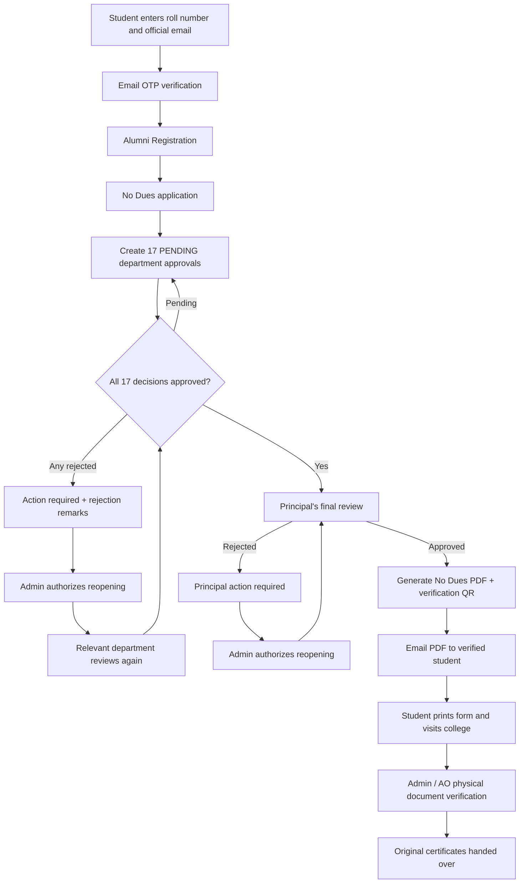
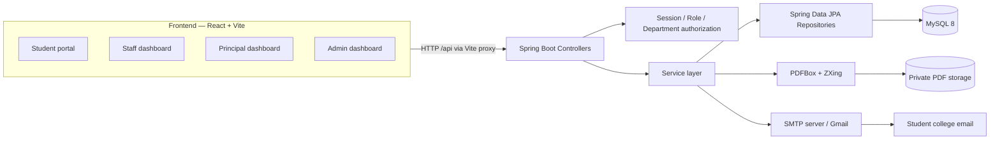
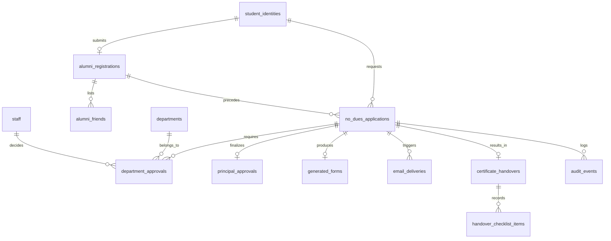

<div align="center">

# 🎓 DCCMP

### Digital Campus Clearance and Certificate Management Platform

**A role-based, full-stack platform for managing student No Dues clearance, departmental approvals, digital verification, and the physical handover of original certificates.**

**Designed for Usharama College of Engineering and Technology**


**[Overview](#-overview) · [Architecture](#-system-architecture) · [Features](#-features) · [Setup](#-getting-started) · [API](#-api-reference) · [Testing](#-testing)**

</div>

---

## 📌 Overview

The **Digital Campus Clearance and Certificate Management Platform (DCCMP)** digitizes the college's No Dues approval procedure while preserving the final, in-person verification required before students receive their **original academic certificates**.

In a conventional clearance process, students must approach multiple college departments individually and obtain approvals on paper. DCCMP provides a single student portal and separate dashboards for departmental staff, the Principal, and the Administrator. The platform tracks decisions, records rejection reasons, creates a verifiable clearance PDF, and documents the physical collection of certificates.

The process consists of two mandatory student forms—**Alumni Registration** followed by **No Dues**—and **17 parallel departmental approvals**. All 17 must approve before the Principal can issue the final decision.

> **Important:** DCCMP generates a *No Dues clearance / certificate-collection form*. It **does not** generate or replace original degree or academic certificates. Actual originals are handed over physically after Admin verification.

### Project objectives

- Reduce manual follow-ups and improve visibility into departmental clearance.
- Enforce a consistent, auditable approval process across the college.
- Protect student identity through verified college-email OTP authentication.
- Prevent unauthorized cross-department decisions.
- Generate college-format clearance documents with recorded approval details and QR verification.
- Maintain a clear distinction between **digital approval**, **email delivery**, and **physical certificate handover**.

## ✨ Features

| Module | Capabilities |
|---|---|
| **Student authentication** | Roll-number validation, `@usharama.in` email matching, expiring OTP, student session |
| **Alumni Registration** | Official Alumni form fields, including five classmates' names/contact numbers |
| **No Dues application** | Separate form, mandatory alumni prerequisite, application tracking |
| **Department dashboards** | Individual staff login; queue, approvals, rejections, and remarks for their assigned department |
| **Parallel workflow** | Exactly 17 required department decisions per submitted application |
| **Reopening** | Admin-authorized reopening of rejected decisions without clearing existing approvals |
| **Principal dashboard** | Final review only after 17/17 departmental approvals |
| **PDF generation** | Official No Dues template, digital approval labels, staff names/timestamps, annex page |
| **QR verification** | Unique verification ID and public limited-information authenticity check |
| **Email notifications** | SMTP-based OTP and approved-PDF attachment delivery; delivery status tracking |
| **Admin dashboard** | Staff management, department management, application monitoring, audit history, reports |
| **Physical handover** | Printed-form validation, document checklist, verification record, one-time handover |

### Role permissions

| Capability | Student | Department Staff | Principal | Admin |
|---|:---:|:---:|:---:|:---:|
| Verify college email with OTP | ✅ | — | — | — |
| Submit Alumni and No Dues forms | ✅ | — | — | — |
| Track own clearance | ✅ | — | — | — |
| Review assigned department queue | — | ✅ | — | — |
| Approve/reject departmental request | — | ✅ | — | — |
| Access detailed Alumni Registration | Own form | Alumni staff only | — | As permitted for administration |
| Final Principal approval | — | — | ✅ | — |
| Create/manage staff accounts | — | — | — | ✅ |
| Authorize rejection reopening | — | — | — | ✅ |
| Verify documents and record handover | — | — | — | ✅ |

**Admin cannot approve on behalf of staff or the Principal.** Staff cannot make decisions for a different department.

## 🏛️ Departments and approval rules

**Every applicant must receive approval from all 17 departments**, regardless of their own branch. Departmental decisions run in parallel.

| No. | Department | Code |
|---:|---|---|
| 1 | EEE HOD | `hod_eee` |
| 2 | Civil HOD | `hod_civil` |
| 3 | ECE HOD | `hod_ece` |
| 4 | CSE HOD | `hod_cse` |
| 5 | Mechanical HOD | `hod_mech` |
| 6 | AI HOD | `hod_ai` |
| 7 | IT HOD | `hod_it` |
| 8 | Hostel | `hostel` |
| 9 | Canteen | `canteen` |
| 10 | Accounts | `accounts` |
| 11 | Scholarship | `scholarship` |
| 12 | Training & Placements | `training_placements` |
| 13 | Examination Section | `examinations` |
| 14 | Games & Sports | `sports` |
| 15 | Alumni | `alumni` |
| 16 | Library | `library` |
| 17 | Special Team | `special_team` |

The department list is seeded through `V2__departments.sql`. A unique `(application_id, department_id)` constraint prevents duplicate department decisions for one application.

## 🔄 Application workflow



**Business invariants:**

1. Alumni Registration must be submitted **before** No Dues.
2. Creating a No Dues application creates **17 PENDING approval records**.
3. A rejection requires remarks and prevents progression to the Principal.
4. Reopening a rejected decision does **not** reset previously approved departments.
5. Only the **Principal** can make the final digital clearance decision.
6. A clearance PDF cannot be issued before Principal approval.
7. Admin handles **AO physical verification**; there is **no separate AO digital approval account**.
8. A generated or emailed PDF is **not proof that original certificates were collected**.

### Main application states

```text
PENDING_DEPARTMENTS
        │
        ├── REJECTED ──> ACTION_REQUIRED ──> reopened ──┐
        │                                                │
        └── 17/17 APPROVED <──────────────────────────────┘
                    │
           PENDING_PRINCIPAL
                    │
          ┌─────────┴──────────┐
       REJECTED            APPROVED
          │                    │
PRINCIPAL_ACTION_REQUIRED      ├── PDF generated
          │                    ├── Email sent / failed / retried
     Admin reopens             └── Admin verification / handover
          │
  PENDING_PRINCIPAL
```

Approval, PDF delivery, and handover are recorded as **separate pieces of state**, so an SMTP problem cannot by itself undo a Principal's decision.

## 🧱 Tech stack

| Component | Technology | Purpose |
|---|---|---|
| Frontend | React 19, Vite 6 | Responsive single-page application |
| UI | Tailwind CSS 4, Lucide React | Styling and interface icons |
| API | Java 21, Spring Boot 4.0.2 | REST services and business logic |
| Persistence | Spring Data JPA, Hibernate | Entity mappings and data access |
| Database | MySQL 8 | Relational application storage |
| Migrations | Flyway | Schema creation and department seeding |
| Authentication | Spring Security, BCrypt, HTTP session, CSRF | Authentication and access-control infrastructure |
| Email | Spring Boot Mail / SMTP | OTP and PDF attachment delivery |
| PDF | Apache PDFBox 3 | Form rendering/overlay and annex |
| Verification QR | ZXing | QR-code generation |
| API documentation | springdoc OpenAPI | Swagger UI |
| Backend tests | JUnit 5 / Spring Boot Test | Rules and application testing |
| Local services | Docker Compose (optional) | MySQL and Mailpit email test inbox |

## 🏗️ System architecture



### Backend package architecture

The backend follows a layered Spring Boot structure under the base package `com.dccmp.backend`:

```text
backend/
├── pom.xml
├── .env.example
└── src/
    ├── main/
    │   ├── java/com/dccmp/backend/
    │   │   ├── DccmpApplication.java
    │   │   ├── config/
    │   │   │   ├── SecurityConfig.java
    │   │   │   ├── Bootstrap.java
    │   │   │   └── DemoAccounts.java
    │   │   ├── controller/
    │   │   │   ├── PublicController.java
    │   │   │   ├── AuthController.java
    │   │   │   ├── StudentController.java
    │   │   │   ├── StaffController.java
    │   │   │   ├── PrincipalController.java
    │   │   │   └── AdminController.java
    │   │   ├── dto/
    │   │   │   └── Records.java
    │   │   ├── entity/                 # JPA entity classes
    │   │   ├── repository/             # Spring Data repository interfaces
    │   │   ├── service/
    │   │   │   ├── IdentityService.java
    │   │   │   ├── WorkflowService.java
    │   │   │   ├── DocumentService.java
    │   │   │   └── HandoverService.java
    │   │   ├── security/
    │   │   │   └── Access.java
    │   │   └── exception/
    │   │       └── ApiError.java
    │   └── resources/
    │       ├── application.yml
    │       └── db/migration/
    │           ├── V1__schema.sql
    │           └── V2__departments.sql
    └── test/java/com/dccmp/backend/service/
        ├── WorkflowRulesTest.java
        └── WorkflowServiceTest.java
```

| Layer | Responsibility |
|---|---|
| `controller` | Routes requests, validates access and coordinates responses |
| `service` | Implements student verification, approval rules, PDF/email and handover |
| `repository` | Database reads and writes through Spring Data JPA |
| `entity` | Mapping of Java classes to relational tables |
| `dto` | Request/response records used by the HTTP API |
| `security` | Current-session identity and role/department checks |
| `config` | Application security, Admin bootstrap, optional demo accounts |
| `exception` | Standardized error handling |

### Frontend layout

```text
frontend/
├── package.json
├── vite.config.js
├── index.html
└── src/
    ├── main.jsx
    ├── App.jsx
    ├── Student.jsx
    ├── Staff.jsx
    ├── Principal.jsx
    ├── Admin.jsx
    ├── components.jsx
    ├── api.js
    └── index.css
```

Public routes include `/`, `/student`, `/employee`, and `/verify/:token`. Employee dashboards are selected according to the authenticated user's role.

### Repository layout

```text
DCCMP/
├── backend/                 # Java / Spring Boot backend
├── frontend/                # React / Vite application
├── reference-forms/         # College reference PDFs
├── docs/                    # Architecture, API, configuration docs
├── scripts/                 # Development / smoke-test utilities
├── docker-compose.yml       # Optional MySQL + Mailpit services
├── DCCMP_Project_Plan.md
├── DCCMP_Codex_Master_Prompt.md
├── PROGRESS.md
├── .env.example
└── README.md
```

## 🗄️ Database design

DCCMP uses MySQL database **`dccmp_db`** with **15 application tables** and an additional Flyway schema-history table managed by Flyway.

| Table | Purpose |
|---|---|
| `student_identities` | Roll number, college email and verification metadata |
| `email_otps` | OTP hashes, validity, attempt counts and consumption |
| `alumni_registrations` | Submitted Alumni Registration fields |
| `alumni_friends` | The five friends recorded with the alumni form |
| `no_dues_applications` | Clearance application information and status |
| `departments` | Seeded HOD and general department records |
| `staff` | Staff/Principal/Admin accounts and BCrypt hashes |
| `department_approvals` | One decision per department per application |
| `principal_approvals` | Principal's final decision |
| `approval_reopenings` | Admin-authorized review reopenings |
| `audit_events` | Recorded workflow actions and their actors |
| `generated_forms` | Protected PDF path, issuance and verification ID |
| `email_deliveries` | Email type, recipient, state and error details |
| `certificate_handovers` | Final collection record and Admin identity |
| `handover_checklist_items` | Physical documentation checks and alternatives |



**Schema management:** `backend/src/main/resources/db/migration/V1__schema.sql` creates tables/constraints, and `V2__departments.sql` inserts all 17 departments. **Do not manually recreate those tables** in a database already managed by Flyway.

To inspect the database:

```sql
USE dccmp_db;
SHOW TABLES;
SELECT id, code, name FROM departments ORDER BY id;
SELECT id, code, name, role, department_id, active FROM staff;
SELECT installed_rank, version, description, success FROM flyway_schema_history;
```

## 📄 Official college forms

The application uses these source documents:

- **Alumni Registration — `URCET/7.22/AC 08`:** identity, family, academics, address, hobbies, placement, job, future plans and five friends.
- **No Dues — `URCET/5.4/FT 01`:** clearance application, departmental decision areas, declaration and AO/Principal sections.

`DocumentService` uses the official No Dues PDF as the first page where available and adds a **digital approval verification annex** showing all 17 department decisions, their recorded approvers and dates, the Principal decision, a verification ID and a QR code. The application does **not** fabricate signatures or stamps.

Students do **not** upload supporting documents. The printed form, student identification, deposit receipt or allowed alternative, mark-sheet photocopies and photograph are checked **in person** before certificate handover.

> **Template paths matter:** `PDF_TEMPLATE=../reference-forms/No_Dues(2).pdf` assumes the backend process is started with `backend/` as its working directory.

## 🚀 Getting started

### Prerequisites

- **Java JDK 21** (`java -version`)
- **Maven 3.9+** (`mvn -version`)
- **Node.js 22+ and npm** (`node -v`, `npm -v`)
- **MySQL 8** (local installation or Docker)
- **IntelliJ IDEA** (recommended for Java development)
- **Gmail App Password** or another authorized SMTP configuration for real email delivery

### 1. Clone the repository

```powershell
git clone <YOUR_GITHUB_REPOSITORY_URL>
cd DCCMP
```

Alternatively, download the repository ZIP from GitHub and extract it.

### 2. Start MySQL (choose one option)

**Option A — Docker Desktop**

From the project root:

```powershell
docker compose up -d
```

The included Compose file starts MySQL on `localhost:3306` and **Mailpit** (local email test inbox) on `localhost:8025`, SMTP port `1025`. The Compose database credentials are for development only.

**Option B — Existing MySQL 8 installation**

Use MySQL Workbench or IntelliJ's Database tool. Create the database if the MySQL user lacks permission to create it automatically:

```sql
CREATE DATABASE IF NOT EXISTS dccmp_db;
```

Flyway creates the **tables and seed data** when the backend starts.

### 3. Create the backend `.env`

From the project root:

```powershell
Copy-Item backend\.env.example backend\.env
```

Open `backend/.env` and set your actual credentials. Example using Gmail SMTP:

```dotenv
# Database
DB_URL=jdbc:mysql://localhost:3306/dccmp_db?createDatabaseIfNotExist=true
DB_USER=root
DB_PASSWORD=REPLACE_WITH_YOUR_MYSQL_PASSWORD

# Backend / frontend
PORT=8080
APP_BASE_URL=http://localhost:5173
SESSION_COOKIE_SECURE=false

# Gmail SMTP (real email delivery)
SMTP_HOST=smtp.gmail.com
SMTP_PORT=587
SMTP_USER=your-account@gmail.com
SMTP_PASSWORD=REPLACE_WITH_YOUR_GOOGLE_APP_PASSWORD
SMTP_AUTH=true
SMTP_STARTTLS=true
MAIL_FROM=your-account@gmail.com

# Initial Admin account
ADMIN_CODE=ADMIN001
ADMIN_PASSWORD=REPLACE_WITH_A_UNIQUE_PASSWORD_OF_12_OR_MORE_CHARS

# Optional development-only staff accounts
DEMO_SEED_STAFF=false
DEMO_STAFF_PASSWORD=

# Generated No Dues documents
PDF_TEMPLATE=../reference-forms/No_Dues(2).pdf
PDF_STORAGE=./private-generated-forms
```

**Never commit a real `.env` file**, real student information, or generated clearance PDFs. Include `.env` and `private-generated-forms/` in `.gitignore`.

The backend imports `.env` using the following setting in `backend/src/main/resources/application.yml`:

```yaml
spring:
  config:
    import: "optional:file:./.env[.properties]"
```

This syntax reads `.env` relative to the **current working directory**. It does not export the file to the operating system's shell.

#### Gmail SMTP setup

1. Enable **2-Step Verification** on the Google account.
2. Create an **App Password** at [Google App Passwords](https://myaccount.google.com/apppasswords), if the account supports them.
3. Enter the App Password as `SMTP_PASSWORD` (without spaces).
4. Use the authorized Gmail address as `SMTP_USER` and normally `MAIL_FROM`.
5. Restart the backend after changing `.env`.

A personal Gmail sender can send to the verified college email; sender and recipient domains do not have to match. Some managed Google Workspace accounts may prohibit App Passwords.

For **local-only email testing**, instead use:

```dotenv
SMTP_HOST=localhost
SMTP_PORT=1025
SMTP_USER=
SMTP_PASSWORD=
SMTP_AUTH=false
SMTP_STARTTLS=false
MAIL_FROM=no-reply@usharama.in
```

Then check messages at `http://localhost:8025`. Mailpit does **not** deliver emails to real inboxes.

### 4. Run the backend

```powershell
cd backend
mvn clean spring-boot:run
```

Or open `backend/pom.xml` as a Maven project in **IntelliJ IDEA**, select **JDK 21**, and run `com.dccmp.backend.DccmpApplication`.

**In IntelliJ set:** `Run → Edit Configurations → Working directory` to the absolute path of `backend/` (where `.env` and `pom.xml` reside). You do not need to copy every variable into the Run Configuration.

Once the app starts, Flyway should report migrations at **version 2** and Tomcat should listen on **port 8080**.

### 5. Run the frontend

Open another terminal from the project root:

```powershell
cd frontend
npm install
npm run dev
```

Vite starts at **http://localhost:5173** and forwards `/api` calls to `http://localhost:8080` using the configured development proxy.

### Local development URLs

| Service | URL |
|---|---|
| Home | http://localhost:5173 |
| Student portal | http://localhost:5173/student |
| Employee login | http://localhost:5173/employee |
| Public verification | `http://localhost:5173/verify/<verification-id>` |
| Backend health | http://localhost:8080/api/public/health |
| API documentation (Swagger UI) | http://localhost:8080/swagger-ui.html |
| Mailpit inbox (only with Compose) | http://localhost:8025 |

## 🔐 Demo and initial credentials

The initial Admin account is created on startup if configured through `ADMIN_CODE` and `ADMIN_PASSWORD`. **Admin passwords are BCrypt-hashed in the `staff` table**.

```text
Admin login ID: ADMIN001
Admin password: The ADMIN_PASSWORD used at first initialization
```

For a local demonstration only, set:

```dotenv
DEMO_SEED_STAFF=true
DEMO_STAFF_PASSWORD=REPLACE_WITH_A_STRONG_DEMO_PASSWORD_12_PLUS_CHARS
```

The backend seeds department accounts with codes `DEMO_<DEPARTMENT_CODE_IN_UPPERCASE>` and a Principal account named `DEMO_PRINCIPAL`. Examples:

```text
DEMO_HOD_CSE
DEMO_HOD_EEE
DEMO_LIBRARY
DEMO_TRAINING_PLACEMENTS
DEMO_PRINCIPAL
```

Every demo account uses the configured `DEMO_STAFF_PASSWORD`. Existing accounts are **not automatically re-passworded** when `.env` changes. Use the Admin dashboard to manage real employee accounts.

> **Security warning:** Disable demo seeding and replace or deactivate demo accounts before any institutional deployment. Never publish real login passwords in the README.

## 🔌 API reference

All endpoints below are prefixed with `/api`. Authentication uses browser sessions and a CSRF token; state-changing requests need the session cookie and `X-XSRF-TOKEN`. Start with `GET /api/public/csrf`. The frontend API client handles the token automatically.

### Public and student endpoints

| Method | Endpoint | Purpose |
|---|---|---|
| `GET` | `/api/public/health` | Health response |
| `GET` | `/api/public/csrf` | Retrieve CSRF token |
| `GET` | `/api/public/departments` | View active departments |
| `POST` | `/api/public/otp/send` | Email verification OTP |
| `POST` | `/api/public/otp/verify` | Verify OTP and create student session |
| `POST` | `/api/student/alumni` | Submit Alumni Registration |
| `GET` | `/api/student/alumni` | View own Alumni Registration |
| `POST` | `/api/student/no-dues` | Submit No Dues application |
| `GET` | `/api/student/applications` | Track own applications |
| `GET` | `/api/student/approved-form/{id}` | Download own issued form |
| `GET` | `/api/public/verify/{token}` | Verify issued form authenticity |

### Staff and Principal endpoints

| Method | Endpoint | Purpose |
|---|---|---|
| `POST` | `/api/auth/login` | Employee login |
| `POST` | `/api/auth/logout` | End session |
| `GET` | `/api/auth/me` | Current employee profile |
| `GET` | `/api/staff/queue` | Assigned department queue |
| `PATCH` | `/api/staff/approvals/{id}/approve` | Approve within assigned department |
| `PATCH` | `/api/staff/approvals/{id}/reject` | Reject with mandatory remarks |
| `GET` | `/api/staff/alumni` | Alumni staff registration details |
| `GET` | `/api/principal/pending` | Fully cleared applications |
| `PATCH` | `/api/principal/applications/{id}/approve` | Final Principal approval and document issuance |
| `PATCH` | `/api/principal/applications/{id}/reject` | Reject with remarks |

### Admin endpoints

| Method | Endpoint | Purpose |
|---|---|---|
| `GET` | `/api/admin/dashboard` | Status counts |
| `GET` | `/api/admin/applications` | Application overview |
| `GET` | `/api/admin/staff` | Staff list |
| `POST` | `/api/admin/staff` | Create staff account |
| `PATCH` | `/api/admin/staff/{id}` | Edit/deactivate/reset staff credentials |
| `PATCH` | `/api/admin/departments/{id}` | Update department display name |
| `POST` | `/api/admin/reopenings` | Authorize rejected decision reopening |
| `GET` | `/api/admin/audit/{appId}` | Application audit events |
| `POST` | `/api/admin/forms/{id}/issue` | Issue/retry PDF for Principal-approved application |
| `POST` | `/api/admin/forms/{id}/resend` | Retry PDF email delivery |
| `GET` | `/api/admin/forms/{id}/download` | Admin PDF download |
| `POST` | `/api/admin/handovers` | Verify and record certificate handover |

**Example: request an OTP**

```http
POST /api/public/otp/send
Content-Type: application/json
X-XSRF-TOKEN: <TOKEN_FROM_PUBLIC_CSRF>
Cookie: <SESSION_COOKIE>

{
  "rollNumber": "24NG5A0501",
  "email": "24ng5a0501@usharama.in"
}
```

**Example: Admin authorizes reopening**

```json
{
  "applicationId": 11,
  "approvalId": 82,
  "principalTarget": false,
  "reason": "Student provided corrected records"
}
```

For detailed payloads and responses, see [`docs/API.md`](docs/API.md) and the local Swagger UI.

## 🛡️ Authentication and security

- Student email must correspond to the normalized roll number. Supported initial formats include `23NG1A0501` (regular) and `24NG5A0501` (lateral-entry).
- OTPs are randomly generated, stored as password hashes, expire, and are limited in attempts and resend frequency.
- Employees authenticate with a unique staff code and BCrypt-hashed password.
- Controller/service authorization checks enforce role and department restrictions.
- Sessions are managed by server-side session attributes; CSRF defenses apply to mutating requests.
- Student PDF downloads are scoped to the verified student session.
- Public document verification exposes limited metadata rather than full student records.
- Audit events record approval and reopening activity.
- PDF files are stored outside public static assets and accessed through protected endpoints.

**Before production use**, add HTTPS and secure cookies, stronger shared/distributed rate limiting, secret management, robust mail retry operations, backups, access logging/monitoring, institutional privacy and retention policies, and a security review. In the current source, `SecurityConfig` permits routes at the filter layer while application access is enforced via explicit role/session checks in controllers; this design should receive additional review and automated authorization testing before public deployment.

## 🧪 Testing

Run these commands on a machine with Java, Maven, Node/npm and MySQL configured:

```powershell
# Backend test suite
cd backend
mvn clean test
mvn package

# Frontend checks
cd ..\frontend
npm install
npm run check
npm run build
```

`npm run check` verifies required frontend files exist; **it is not a full UI or end-to-end test**.

### Manual end-to-end acceptance scenario

- [ ] Launch MySQL, backend and frontend.
- [ ] Confirm `/api/public/health` responds successfully.
- [ ] Send OTP to a controlled college test email and verify it.
- [ ] Complete Alumni Registration with all required fields and five friends.
- [ ] Submit No Dues and confirm **17 PENDING approvals**.
- [ ] Sign in as one department employee; approve or reject an assigned request.
- [ ] Confirm employees cannot approve another department's requests.
- [ ] Verify rejected requests require remarks and block progression.
- [ ] Use Admin reopening, then reapprove the rejected department.
- [ ] Complete all 17 department approvals.
- [ ] Confirm only the Principal can approve the final stage.
- [ ] Generate the official-format PDF, 17-approval annex and QR code.
- [ ] Verify email attachment delivery using Gmail or Mailpit.
- [ ] Validate the verification ID on the public verification page.
- [ ] Verify required physical documents in Admin.
- [ ] Record original certificate handover; confirm a duplicate handover is rejected.

### Verification status

This README describes **the project source and intended workflow**. Local startup logs supplied during development confirmed MySQL connectivity, Flyway migrations at version 2 and Spring Boot initialization. Other issues—including a Jackson 3 configuration incompatibility, a demo-password startup check, and a repository-injection problem during PDF generation—required fixes during setup. **A complete clean build, automated test suite, Gmail delivery test and final end-to-end run have not been independently certified here.** See [`PROGRESS.md`](PROGRESS.md) and keep it updated with actual results from your environment.

## 🧰 Troubleshooting

| Problem | What to check |
|---|---|
| `Access denied for user` | `DB_USER`, `DB_PASSWORD`, MySQL account privileges |
| `Communications link failure` | MySQL running and listening on port 3306 |
| Flyway migration failure | First SQL error, migration version and `flyway_schema_history` |
| `.env` values not loaded | IntelliJ working directory points to `backend/`; config import exists |
| `DEMO_STAFF_PASSWORD must have at least 12 characters` | Provide a longer value or disable `DEMO_SEED_STAFF` |
| `BeanDefinitionOverrideException: demoAccounts` | Rename the `@Bean` method to `seedDemoAccounts` in `DemoAccounts.java` |
| Jackson `write-dates-as-timestamps` binding error | Remove outdated `spring.jackson.serialization.write-dates-as-timestamps` from `application.yml` |
| Gmail SMTP authentication rejected | Gmail App Password, account policy, `SMTP_USER`, `MAIL_FROM` |
| SMTP timeout | Firewall/network blocking `smtp.gmail.com:587` |
| `flow.approvals` is null during PDF generation | Inject `ApprovalRepository`, `DepartmentRepository` and `PrincipalDecisionRepository` directly into `DocumentService` |
| PDF template not found | Check `reference-forms/` and the backend working directory |
| Browser API calls fail | Verify backend port 8080, frontend proxy port 5173 and CSRF token handling |

## 📸 Screenshots and demonstration

Screenshots are **not included** in this README yet. To showcase the repository on GitHub, capture actual screens from your running application and save them under `docs/screenshots/` (avoid exposing real student identities, phone numbers, OTPs, or staff information). Suggested screenshots:

1. Home page / student portal
2. OTP verification and Alumni Registration
3. No Dues application and approval tracker
4. Staff departmental queue
5. Principal approval dashboard
6. Admin dashboard and verification checklist
7. Generated No Dues PDF with verification annex (using dummy data)

After adding the images, reference them in this README with standard Markdown, for example ``.

## 🔧 Suggested future enhancements

- Institution SSO and managed email-provider integration.
- Configurable department approval policies while retaining approval snapshots.
- Richer reporting, filtering, exports and performance indicators.
- Stronger automated email retry queue and operational monitoring.
- Signed/auditable issuance events and enhanced QR validation.
- More comprehensive integration, accessibility and security testing.
- Deployment automation, structured logging and backup/restore procedures.

## 🤝 Contributing

Contributions and issue reports can follow this workflow:

1. Open an issue describing the problem or improvement.
2. Create a feature branch.
3. Implement the change with appropriate tests.
4. Run the backend and frontend verification commands.
5. Open a pull request documenting the change and how it was verified.

Do not include secrets, real student records, production database dumps or unauthorized institutional documents in issues or pull requests.

## 📜 License and institutional assets

**No open-source license has been selected for this repository.** Add an appropriate `LICENSE` file with permission from the project owner before stating that third parties may reuse the code. Institutional names, branding, and official PDF templates may be subject to separate college permissions; verify that they can be published publicly before pushing `reference-forms/` to GitHub.

---

<div align="center">

**DCCMP — Digitizing campus clearance while preserving accountable physical verification.**

*Built with Java · Spring Boot · React · MySQL*

</div>
