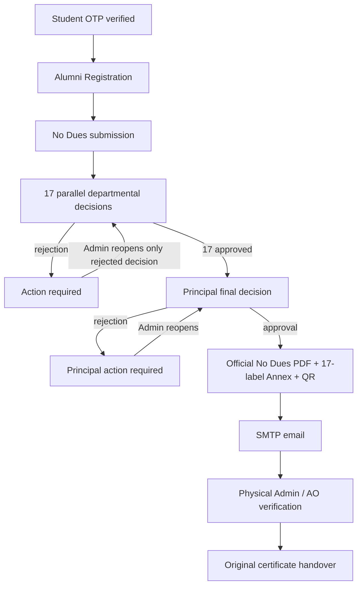
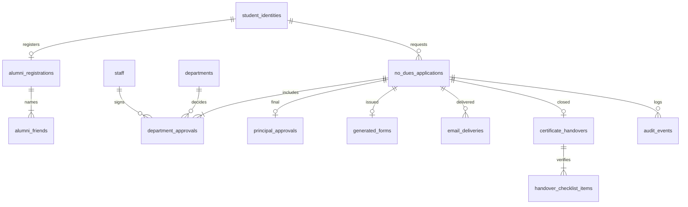

# Architecture and core state transitions

## ER overview

## State dimensions

- Clearance: `PENDING_DEPARTMENTS`, `ACTION_REQUIRED`, `PENDING_PRINCIPAL`, `PRINCIPAL_ACTION_REQUIRED`, `APPROVED`.
- Department: `PENDING`, `APPROVED`, `REJECTED`.
- Principal: `PENDING`, `APPROVED`, `REJECTED`.
- Email: `EMAIL_PENDING`, `EMAIL_SENT`, `EMAIL_FAILED`.
- Handover: `NOT_COLLECTED`, `HANDED_OVER`.

There are no automatic department exemptions. Only department staff may decide for a department, and only Principal may finally approve. Admin may authorize reopening, issue/reissue PDF for already approved applications, and physically verify document collection. A generated PDF does not imply collected certificates.

## Layered Spring Boot backend packages

All backend Java classes are located under `com.dccmp.backend`. Spring Boot automatically scans its subpackages.

| Package | Responsibility |
|---|---|
| `controller` | Six role-focused controllers exposing the existing 34 API endpoints |
| `service` | Workflow, OTP/identity, PDF/email, and physical handover business logic |
| `repository` | Spring Data JPA repository interfaces |
| `entity` | Persistence entities for MySQL tables |
| `dto` | Typed API request/response records (`Records`) |
| `security` | Employee/student session and authorization checks |
| `config` | Spring Security and bootstrap account configuration |
| `exception` | Consistent API exception responses |

This refactor preserves the previous API paths so that frontend clients are compatible.
